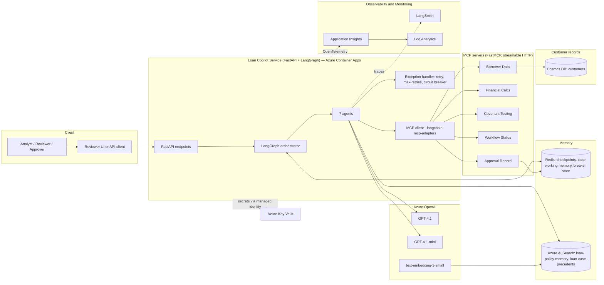
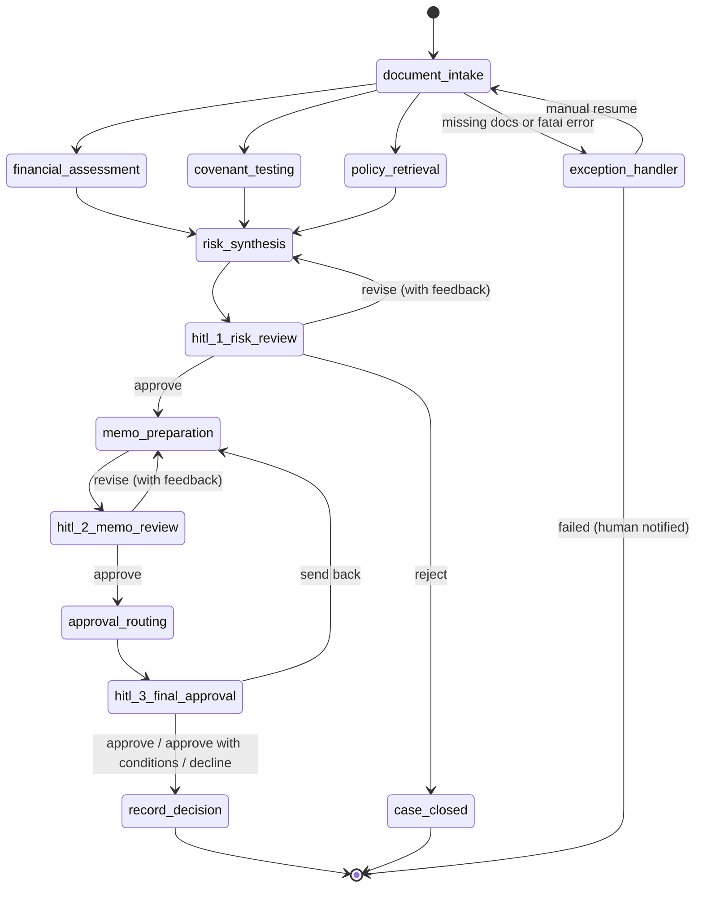
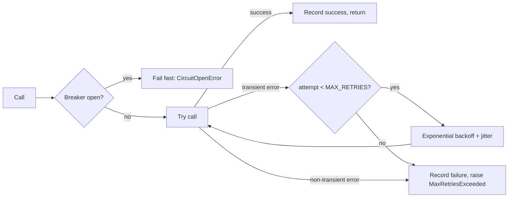

# Loan Underwriting Multi-Agent Copilot — Architecture & Delivery Plan

An Azure-native, multi-agent copilot that takes a commercial loan case from raw documents to a recorded credit decision. It is orchestrated with **LangGraph**, reasons with **Azure OpenAI (GPT-4.1 / GPT-4.1-mini)**, acts through **five MCP servers** and **function calling**, remembers with **Redis** (short-term) and **Azure AI Search** (long-term), reads customer records from **Azure Cosmos DB**, is traced in **LangSmith**, and is monitored with **Azure Monitor** (Application Insights + Log Analytics).

---

## 1. Goals and scope

| Goal | How it is met |
|---|---|
| Reduce analyst time per loan case | 7 specialised agents automate intake, analysis, drafting and routing |
| Keep humans accountable for credit decisions | 3 human-in-the-loop (HITL) checkpoints; no decision is recorded without a human |
| Deterministic numbers | All ratios and covenant tests are computed by MCP tools, never by the LLM |
| Grounded in policy and precedent | Policy and previously approved cases are retrieved from Azure AI Search |
| One customer view during a case | Borrower Data MCP reads one Cosmos DB customer document (profile, facilities, related parties) |
| Resilient | Retries with backoff, max-retry limits, and circuit breakers around every external dependency |
| Auditable and observable | Every step is traced (LangSmith), logged and measured (Azure Monitor), and written to an audit trail (Workflow Status MCP) |

**Input — one loan case = 4 documents:**

1. Borrower request (amount, purpose, tenor, collateral, requested terms)
2. Financial statements (income statement, balance sheet, cash flow — multi-year)
3. Management report (strategy, outlook, risks, management commentary)
4. Credit report (bureau score, payment history, existing facilities, defaults/litigation)

**Output:** a risk assessment, a credit memo, an approval route, and a recorded final decision (approve / approve with conditions / decline).

**Left out of this minimum build:** a Databricks lakehouse, peer-benchmark tables, extra Cosmos containers for facilities, cases, and decisions, covenant stress tests, a LangSmith evaluation suite, saved KQL query files, and a reviewer UI. A live core-banking feed and OCR of scanned images are also out of scope. Customer records are synthetic Cosmos documents. Case documents are Markdown or text-based PDF.

---

## 2. High-level architecture



### Technology map

| Concern | Technology | Notes |
|---|---|---|
| Orchestration | LangGraph | `StateGraph`, parallel fan-out/fan-in, `interrupt()` for HITL, conditional edges |
| LLMs | Azure OpenAI GPT-4.1, GPT-4.1-mini | via `langchain-openai` `AzureChatOpenAI` |
| Embeddings | Azure OpenAI `text-embedding-3-small` (1536 dims) | same model as the existing `rag` project |
| Tools (remote) | MCP — 5 servers built with the `mcp` Python SDK (FastMCP) | streamable HTTP transport, one container each |
| Tools (in-process) | LangChain `@tool` functions + OpenAI function calling | `parse_document`, `search_policy`, `search_precedents` |
| Structured outputs | Function calling via `with_structured_output(PydanticModel)` | every agent returns a typed Pydantic object |
| Short-term memory | Redis (Redis Stack locally, Azure Managed Redis in cloud) | LangGraph checkpointer + case cache + breaker state |
| Long-term memory | Azure AI Search | indexes `loan-policy-memory` and `loan-case-precedents` |
| Customer records | Azure Cosmos DB for NoSQL | one container, `customers`; point read by `borrowerId` |
| Decisions and audit | Redis | Approval Record MCP and Workflow Status MCP. Approved cases are also copied to Azure AI Search |
| Resilience | `tenacity` + Redis-backed circuit breaker | one module, `resilience.py`; wraps LLM, MCP, Azure AI Search, Cosmos, and Redis calls |
| Tracing | LangSmith | per-run traces, metadata `case_id`, eval datasets |
| Monitoring | Azure Monitor OpenTelemetry Distro → Application Insights → Log Analytics | custom metrics, KQL queries, alerts |
| API | FastAPI + Uvicorn | start case, get status, submit HITL decisions |
| Secrets | Azure Key Vault + Managed Identity (`azure-identity`) | `.env` only for local dev |
| Packaging | Docker, Azure Container Registry, Azure Container Apps | matches the existing `rag/acr-deploy.md` flow |

---

## 3. Agent workflow (LangGraph)



**Execution rules**

- **Sequential start:** Document Intake must succeed (all 4 documents present and parsed) before analysis starts.
- **Parallel middle:** Financial Assessment, Covenant Testing and Policy Retrieval run in the same LangGraph super-step. Each writes to its own state key, so they don't conflict; shared lists (`audit_log`, `errors`) use `operator.add` reducers.
- **Fan-in:** Risk Synthesis starts only after all three parallel branches finish (LangGraph waits for every incoming edge).
- **HITL:** each checkpoint node calls `interrupt(payload)`. The graph state is persisted in Redis, and the API resumes it with `Command(resume=decision)`. A case can stay paused for days without holding a process.
- **Revision loops:** "revise" decisions send reviewer feedback back to the producing agent, capped at `MAX_REVISIONS = 3` per checkpoint. After that the case is escalated.
- **Every node** writes a status event through the Workflow Status MCP server for the audit trail.

---

## 4. The 7 agents

| # | Agent | Model | Inputs | Tools used | Output (Pydantic) |
|---|---|---|---|---|---|
| 1 | **Document Intake** | GPT-4.1-mini | raw files | `parse_document` (local), Borrower Data MCP, Workflow Status MCP | `IntakeResult` — classified docs, extracted fields, completeness check |
| 2 | **Financial Assessment** | GPT-4.1 | extracted financials, management report | Financial Calcs MCP | `FinancialAssessment` — ratios, trends, strengths, weaknesses |
| 3 | **Covenant Testing** | GPT-4.1-mini | financials, proposed covenants | Financial Calcs MCP, Covenant Testing MCP | `CovenantResult` — each covenant pass/fail, headroom, pro-forma |
| 4 | **Policy Retrieval** | GPT-4.1-mini | loan type, industry, amount | `search_policy`, `search_precedents` (Azure AI Search, local tools) | `PolicyContext` — applicable policy clauses + similar approved cases |
| 5 | **Risk Synthesis** | GPT-4.1 | outputs 2–4, credit report, customer record | Borrower Data MCP | `RiskAssessment` — risk grade 1–10, key risks, mitigants, recommendation |
| 6 | **Memo Preparation** | GPT-4.1 | all prior outputs + HITL 1 feedback | `search_precedents` (format examples) | `CreditMemo` — structured Markdown memo |
| 7 | **Approval Routing** | GPT-4.1-mini | memo, risk grade, amount | Workflow Status MCP, Approval Record MCP | `ApprovalRoute` — approver level, conditions, justification |

**Design principle:** LLMs interpret, explain and write. **Numbers come from tools.** Agents must cite the tool result for every figure they quote, and Risk Synthesis is told to reject any unsupported figure.

### 4.1 Agent details

1. **Document Intake** classifies each uploaded file into one of the 4 document types, extracts key fields with structured output (borrower name, ID, requested amount, tenor, collateral, financial line items by year, bureau score), validates completeness, and calls `get_borrower_profile`. That call is one Cosmos DB point read. The legal name, industry, facilities, and related parties on the case come from that document, and the uploaded request is checked against it. A missing document routes the case to the exception handler with `MISSING_DOCUMENTS`. An unknown customer id stops the case with `UNKNOWN_CUSTOMER`.
2. **Financial Assessment** calls Financial Calcs MCP `calculate_ratios` on the uploaded statements. The tool returns DSCR, Debt/EBITDA, current ratio, interest coverage, EBITDA margin, revenue growth, and leverage by year. The agent interprets the trend and compares it with the management report.
3. **Covenant Testing** maps the proposed covenants from the borrower request (or policy defaults) to Covenant Testing MCP, tests current and pro-forma figures (including the new debt), and reports headroom and breaches.
4. **Policy Retrieval** rewrites the case into retrieval queries, searches the `loan-policy-memory` index (lending limits, industry appetite, collateral rules) and the `loan-case-precedents` index (similar approved cases, filtered by industry and amount band), and returns cited clauses.
5. **Risk Synthesis** merges everything into a risk grade, key risks and mitigants, policy exceptions, and a recommendation (approve / approve with conditions / decline). Existing facilities and related parties come from the same Cosmos customer document. Its output is reviewed at **HITL #1**.
6. **Memo Preparation** drafts the credit memo: executive summary, borrower overview, facility request, financial analysis, covenant analysis, risk assessment, policy compliance and exceptions, recommendation, and conditions. Its output is reviewed at **HITL #2**.
7. **Approval Routing** calls Approval Record MCP `get_authority_matrix` (amount × risk grade), registers the route with Workflow Status MCP, and prepares the approval package. The **HITL #3** approver decides. Approval Record MCP writes that decision to Redis. Approved cases are embedded and uploaded to the `loan-case-precedents` index.

**Example delegated-authority matrix** (sample data; configurable):

| Amount | Risk grade 1–4 | Risk grade 5–6 | Risk grade 7+ |
|---|---|---|---|
| ≤ $1M | Credit Officer | Senior Credit Officer | Credit Committee |
| ≤ $5M | Senior Credit Officer | Credit Committee | Credit Committee |
| ≤ $25M | Credit Committee | Credit Committee | Board Credit Committee |
| > $25M | Board Credit Committee | Board Credit Committee | Board Credit Committee |

---

## 5. Shared graph state

```python
class LoanCaseState(TypedDict):
    case_id: str
    documents: list[DocumentRef]                     # uploaded files (path/blob URI, type)
    intake: IntakeResult | None
    financials: FinancialAssessment | None          # parallel branch 1
    covenants: CovenantResult | None                # parallel branch 2
    policy: PolicyContext | None                    # parallel branch 3
    risk: RiskAssessment | None
    memo: CreditMemo | None
    route: ApprovalRoute | None
    hitl_decisions: Annotated[list[HitlDecision], operator.add]
    revision_counts: dict[str, int]                 # per checkpoint
    errors: Annotated[list[AgentError], operator.add]
    audit_log: Annotated[list[AuditEvent], operator.add]
    status: Literal["intake", "analysis", "risk_review", "memo_review",
                    "final_approval", "approved", "declined", "rejected", "failed"]
```

All agent outputs are Pydantic models, so they are validated when produced, serialised into the Redis checkpoint, and rendered for reviewers.

---

## 6. Tooling: MCP, tool calls and function calling

The solution uses three tool mechanisms on purpose:

| Mechanism | What it is here | Examples |
|---|---|---|
| **MCP tools** | Remote, independently deployable tool servers that any MCP client can discover | the 5 servers below |
| **Tool calls (LangChain `@tool`)** | In-process Python tools bound to the LLM with `bind_tools()`; the model decides when to call them | `parse_document`, `search_policy`, `search_precedents` |
| **Function calling for structured output** | Azure OpenAI function calling used to force a JSON schema reply | `llm.with_structured_output(RiskAssessment)` in every agent |

MCP tools are loaded with `langchain-mcp-adapters` (`MultiServerMCPClient`), so they look like ordinary LangChain tools to the agents. Each agent gets only the tools it needs (least privilege).

### 6.1 MCP servers

| Server | Port (local) | Tools | Backing store |
|---|---|---|---|
| **Borrower Data** | 8101 | `get_borrower_profile(borrower_id)`, `search_borrowers(name)` | Cosmos DB `customers` |
| **Financial Calcs** | 8102 | `calculate_ratios(financials)`, `pro_forma_debt_service(financials, new_loan)` | pure Python, deterministic |
| **Covenant Testing** | 8103 | `list_standard_covenants(loan_type)`, `test_covenants(ratios, covenants)` | `data/covenants.yaml` |
| **Workflow Status** | 8104 | `create_case(...)`, `update_status(case_id, stage, status, note)`, `get_case_status(case_id)`, `get_audit_trail(case_id)` | Redis |
| **Approval Record** | 8105 | `get_authority_matrix()`, `record_hitl_decision(...)`, `record_final_decision(...)`, `get_decision(case_id)` | Redis for decisions, `data/authority_matrix.yaml` for the matrix |

**Example standard covenants** (sample data): minimum DSCR 1.25x, maximum Debt/EBITDA 3.5x, minimum current ratio 1.2x, minimum interest coverage 2.0x, maximum total liabilities / tangible net worth 3.0x.

---

## 7. Memory

### 7.1 Short-term — Redis

| Key / feature | Purpose | TTL |
|---|---|---|
| LangGraph checkpointer (`langgraph-checkpoint-redis`) | durable graph state; required for `interrupt()` / resume | none while a case is open |
| `case:{id}:cache:{tool}:{hash}` | cache of MCP results within a case (avoid recomputation on revisions) | 24h |
| `case:{id}:status`, `case:{id}:audit` (stream) | workflow status and audit trail (Workflow Status MCP) | kept |
| `decision:{case_id}` | HITL decisions and the final decision (Approval Record MCP) | kept |
| `cb:{dependency}` | circuit-breaker state shared across replicas | rolling window |

> The Redis checkpointer needs the RedisJSON and RediSearch modules. Locally use the `redis/redis-stack` Docker image; in Azure use **Azure Managed Redis** (which includes those modules), not Basic/Standard Azure Cache for Redis.

### 7.2 Long-term — Azure AI Search

One Azure AI Search service holds two indexes. The two memories have different fields, so they are separate indexes rather than one shared schema. This is the same stack as the existing `rag` project: `azure-search-documents`, an HNSW vector profile, and a `content_vector` field of 1,536 singles from `text-embedding-3-small` (cosine).

Queries are hybrid. Each search sends the query text (BM25) and a `VectorizedQuery` together, then filters on metadata before ranking. A covenant name or policy ID still matches when the wording in the case differs from the policy.

| Index | Content | Filterable fields | Written by |
|---|---|---|---|
| `loan-policy-memory` | chunked credit policy, lending guidelines, industry appetite, collateral rules | `policy_id`, `section`, `version`, `effective_date`, `topic` | `ingest_policies.py` |
| `loan-case-precedents` | summaries of previously **approved** cases (memo summary + key ratios + conditions) | `industry`, `amount_band`, `risk_grade`, `decision`, `decision_date` | `seed_precedents.py` + `record_decision` node (new approvals) |

Shared fields on both indexes, matching `rag/ls_10_search_index.py`: `id` (key), `title`, `content`, `content_vector`, `source_file`, `embedding_model`. Index creation and upload use `SearchIndexClient` and `SearchClient`. The ingestion scripts use the admin key. The running app reads both indexes and writes only `loan-case-precedents`, using a query key locally and a managed identity (`Search Index Data Contributor`) in Azure.

### 7.3 Customer records — Azure Cosmos DB

Cosmos DB holds customer records and nothing else. One database, `loan_underwriting`. One container, `customers`. Partition key `/borrowerId`. Document id is the borrower id.

Facilities and related parties are fields on that document, so Document Intake and Risk Synthesis share one point read, `get_borrower_profile`.

```json
{
  "id": "BRW-1008",
  "borrowerId": "BRW-1008",
  "legalName": "Northwind Packaging LLC",
  "industry": "Manufacturing",
  "kycStatus": "current",
  "officers": [{ "name": "L. Okonkwo", "role": "CEO" }],
  "relatedParties": [{ "borrowerId": "BRW-1019", "relationship": "common_ownership" }],
  "facilities": [{ "facilityId": "FAC-44", "limit": 2000000, "outstanding": 1250000, "type": "revolver" }]
}
```

`scripts/seed_cosmos.py` loads `data/borrowers.json`. Agents do not update customer records. Locally, Docker Compose runs the Cosmos emulator. In Azure, the Borrower Data MCP server uses a managed identity.

The credit report stays an uploaded case document. Multi-year ratios come from those uploaded statements through Financial Calcs MCP. Similar past approvals come from the `loan-case-precedents` index.

### 7.4 Which store answers which question

| Question during a case | Store |
|---|---|
| What is the graph waiting on, and what did this node just produce? | Redis checkpoint |
| Who is this customer, and what facilities and related parties are already on book? | Cosmos DB `customers` |
| What did the reviewers decide, and where is the audit trail? | Redis (`decision:{case_id}`, `case:{id}:audit`) |
| Which policy clause and which similar approved memo apply? | Azure AI Search |
| What are DSCR, leverage, and the covenant result? | Financial Calcs MCP and Covenant Testing MCP, from the uploaded statements |

---

## 8. Exception handling: retries, max-retries, circuit breaker

Every external call (Azure OpenAI, MCP, Azure AI Search, Cosmos DB, Redis) goes through one `resilient_call` in `resilience.py`.



| Setting | Default | Notes |
|---|---|---|
| `MAX_RETRIES` | 3 | per call |
| Backoff | exponential 1s → 2s → 4s with jitter, capped at 20s | honours `Retry-After` on HTTP 429 |
| Retry on | 429, 5xx, timeouts, connection errors | |
| Do not retry | 400, 401/403, schema-validation errors (these get one "repair" re-prompt instead) | |
| Breaker threshold | 5 failures in 60s → **OPEN** | per dependency |
| Breaker cool-down | 30s → **HALF-OPEN** (1 trial call) → **CLOSED** on success | |
| Model fallback | GPT-4.1 breaker open → use GPT-4.1-mini, flagged `degraded=True` | reviewers see the flag |

**Node-level handling:** each agent node is wrapped by `@agent_node`, which catches errors, appends an `AgentError` to state, and emits telemetry. Conditional edges then decide:

- **Non-critical failure** (precedent search is down): continue in degraded mode. Risk Synthesis says that similar approved cases were unavailable.
- **Critical failure** (intake, Cosmos customer lookup, financial calcs, covenant testing, writing the final decision to Redis): route to the `exception_handler` node. It marks the case `failed` through Workflow Status, alerts through Azure Monitor, and interrupts for manual resume. Because the state is checkpointed, a resumed case restarts from the failed node.

---

## 9. Human-in-the-loop checkpoints

| # | After | Reviewer | Options | Payload shown |
|---|---|---|---|---|
| 1 | Risk Synthesis | Credit Analyst | approve / revise (feedback) / reject | risk grade, key risks, mitigants, covenant breaches, policy exceptions |
| 2 | Memo Preparation | Senior Analyst | approve / revise (feedback, optional section edits) | full credit memo |
| 3 | Approval Routing | Approver at the routed authority level | approve / approve with conditions / decline / send back | memo, route, conditions, precedents |

Every decision is recorded with reviewer ID, timestamp, decision, and comments (Approval Record MCP + `hitl_decisions` state). HITL wait time is a tracked metric.

---

## 10. Model allocation

| Model | Used by | Why |
|---|---|---|
| **GPT-4.1** | Financial Assessment, Risk Synthesis, Memo Preparation | deep reasoning, long-context synthesis, writing quality |
| **GPT-4.1-mini** | Document Intake, Covenant Testing, Policy Retrieval, Approval Routing | extraction, tool orchestration, classification; lower cost and latency |
| **text-embedding-3-small** | Azure AI Search ingestion and queries | matches the existing `rag` project |

The primary deployment is `gpt-6.1-terra`. It is configuration (`AZURE_OPENAI_DEPLOYMENT`), so it can be swapped without code changes.

---

## 11. Observability and monitoring

**LangSmith (LLM observability)**

- `LANGSMITH_TRACING=true`, project `loan-underwriting-copilot`.
- Every run is tagged with `case_id`, `stage`, `agent`, `model`, and `degraded`.
- A case is one LangSmith trace, tagged with `case_id`, `stage`, and `agent`.

**Azure Monitor (platform monitoring)**

- `azure-monitor-opentelemetry` exports traces and logs to **Application Insights**, stored in a **Log Analytics** workspace.
- `case_id` is an OpenTelemetry attribute, so one case can be followed from the API through the graph to the MCP servers.
- One alert: the circuit breaker opens, or the error rate is above 5% for 5 minutes.

---

## 12. Security and compliance

- Secrets (Azure OpenAI, Azure AI Search, Cosmos DB, LangSmith, Redis) live in **Key Vault**. In Azure they are read with **Managed Identity**; locally they come from `.env`. The Search admin key follows the same pattern as `rag/ls_10_search_index.py`.
- MCP servers run on an internal Container Apps network, with a bearer-token check between the app and the MCP servers.
- The customer record in Cosmos DB is the system of record for borrower identity. Borrower identifiers are masked in LangSmith traces. Case progress and decisions stay in Redis.
- Each agent's tool list is restricted to what it needs. Only the `record_decision` node, after HITL #3, can call `record_final_decision`.
- The audit trail is an append-only Redis stream. Each HITL decision is stored on `decision:{case_id}`.

---

## 13. API surface (FastAPI)

| Method & path | Purpose |
|---|---|
| `POST /cases` | upload the 4 documents, or name a sample case; start the graph and return `case_id` |
| `GET /cases/{case_id}` | current status, stage, and outputs so far |
| `GET /cases/{case_id}/pending` | the HITL payload the graph is waiting on |
| `POST /cases/{case_id}/decisions` | submit a HITL decision; resumes the graph |
| `GET /cases/{case_id}/memo` | latest credit memo (Markdown) |
| `GET /cases/{case_id}/audit` | audit trail |
| `GET /health` | liveness plus dependency/breaker status |

---

## 14. Proposed folder structure

```text
finUseCase/
├── ARCHITECTURE.md
├── usecase_rummary.txt
├── README.md
├── requirements.txt
├── .env.example
├── docker-compose.yml              # redis-stack, cosmos emulator, 5 MCP servers, app
├── Dockerfile
├── data/
│   ├── sample_cases/
│   │   ├── case_001_strong/        # 4 case documents
│   │   ├── case_002_borderline/
│   │   └── case_003_breach/
│   ├── policies/                   # -> loan-policy-memory
│   ├── precedents/                 # -> loan-case-precedents
│   ├── borrowers.json              # seed for Cosmos customers
│   ├── covenants.yaml
│   └── authority_matrix.yaml
├── mcp_servers/
│   ├── borrower_data/server.py
│   ├── financial_calcs/server.py
│   ├── covenant_testing/server.py
│   ├── workflow_status/server.py
│   ├── approval_record/server.py
│   └── Dockerfile
├── src/loan_copilot/
│   ├── config.py
│   ├── llm.py
│   ├── state.py
│   ├── schemas.py
│   ├── graph.py                    # agents, parallel branches, 3 HITL interrupts
│   ├── resilience.py               # retry, max retries, circuit breaker
│   ├── observability.py            # LangSmith tags and Azure Monitor
│   ├── agents/                     # one module per agent (7)
│   ├── prompts/                    # one prompt per agent (7)
│   ├── tools/
│   │   ├── mcp_client.py
│   │   └── local_tools.py          # parse_document, search_policy, search_precedents
│   ├── memory/
│   │   ├── redis_store.py
│   │   └── search_store.py
│   └── api/main.py
├── scripts/
│   ├── ingest_policies.py
│   ├── seed_precedents.py
│   ├── seed_cosmos.py
│   └── run_case.py
├── infra/
│   └── deploy.md
└── tests/
```

---

## 15. Configuration (`.env.example` preview)

```text
KEY_VAULT_NAME=clinic-kv-tc-training
USE_KEY_VAULT=true
KEY_VAULT_OPENAI_ENDPOINT_SECRET=az-openai-endpoint
KEY_VAULT_OPENAI_KEY_SECRET=az-openai-apikey
KEY_VAULT_SEARCH_KEY_SECRET=clinic-ss-api-key
AZURE_OPENAI_ENDPOINT=                # explicit value overrides Key Vault
AZURE_OPENAI_API_KEY=                 # explicit value overrides Key Vault
AZURE_OPENAI_API_VERSION=2025-01-01-preview
AZURE_OPENAI_DEPLOYMENT=gpt-6.1-terra
AZURE_OPENAI_DEPLOYMENT_MINI=gpt-6.1-terra
AZURE_OPENAI_DEPLOYMENT_EMBEDDING=text-embedding-3-small

REDIS_URL=redis://localhost:6379

AZURE_SEARCH_ENDPOINT=https://<service>.search.windows.net
AZURE_SEARCH_API_KEY=                 # admin key locally; empty when using managed identity
AZURE_SEARCH_INDEX_POLICIES=loan-policy-memory
AZURE_SEARCH_INDEX_PRECEDENTS=loan-case-precedents

COSMOS_ENDPOINT=https://localhost:8081
COSMOS_KEY=                           # emulator key locally; empty when using managed identity
COSMOS_DATABASE=loan_underwriting
COSMOS_CONTAINER_CUSTOMERS=customers

MCP_BORROWER_DATA_URL=http://localhost:8101/mcp
MCP_FINANCIAL_CALCS_URL=http://localhost:8102/mcp
MCP_COVENANT_TESTING_URL=http://localhost:8103/mcp
MCP_WORKFLOW_STATUS_URL=http://localhost:8104/mcp
MCP_APPROVAL_RECORD_URL=http://localhost:8105/mcp
MCP_AUTH_TOKEN=

LANGSMITH_TRACING=true
LANGSMITH_API_KEY=
LANGSMITH_PROJECT=loan-underwriting-copilot

APPLICATIONINSIGHTS_CONNECTION_STRING=
KEY_VAULT_URL=

MAX_RETRIES=3
CB_FAILURE_THRESHOLD=5
CB_WINDOW_SECONDS=60
CB_COOLDOWN_SECONDS=30
MAX_REVISIONS=3
```

---

## 16. Assumptions and open decisions

These are defaults chosen for this design. Change any of them when giving the next prompts.

1. **Language/runtime:** Python 3.11, same as the existing `rag` project.
2. **Customer records** are synthetic documents in one Cosmos container, seeded from `borrowers.json`. The Cosmos emulator is the local account.
3. **Decisions and the audit trail** stay in Redis. Approved cases are copied to Azure AI Search. There is no second database for them.
4. **Sample data** is synthetic. The existing `rag/finance` statements and management report can be reused as a starting point for one case.
5. **Document formats:** Markdown and text-based PDF (`pypdf`). No OCR.
6. **Raw document storage:** local `data/` folder.
7. **Reviewer UI:** the API and a CLI with console prompts for the three checkpoints.
8. **Deployment target:** Azure Container Apps for the app and the 5 MCP servers, plus Azure Managed Redis, one Cosmos DB account, and one Azure AI Search service.

---

## 17. Next steps to completion

Each step is sized to be one prompt. Each builds on the previous one and ends with something runnable or testable.

### Step 1 — Project scaffolding and configuration
- Create the folder structure from section 14, `requirements.txt`, `.env.example`, and `config.py` (pydantic-settings + optional Key Vault loader).
- `docker-compose.yml` with `redis/redis-stack` only (MCP servers are added in step 3).
- `llm.py` factory for GPT-4.1 / GPT-4.1-mini / embeddings and a smoke-test script.
- **Done when:** `python -m loan_copilot.llm` returns a reply from both deployments, and Redis is reachable.

### Step 2 — Sample data
- Three synthetic loan cases (strong / borderline / covenant breach), each with the 4 documents.
- A short credit-policy set and a handful of approved precedent summaries.
- `borrowers.json` as Cosmos customer documents (section 7.3), with facilities and related parties on the same document. `covenants.yaml` and `authority_matrix.yaml`.
- **Done when:** every case folder has 4 documents with consistent numbers, and each borrower id exists in `borrowers.json`.

### Step 3 — The 5 MCP servers
- Add the Cosmos emulator to `docker-compose.yml` and `scripts/seed_cosmos.py`.
- Borrower Data reads the `customers` container. Financial Calcs and Covenant Testing are pure Python over `covenants.yaml`. Workflow Status and Approval Record use Redis. The authority matrix is read from `authority_matrix.yaml`.
- **Done when:** all 5 servers start, `get_borrower_profile("BRW-1008")` returns facilities on that document, and a recorded decision can be read back from Redis.

### Step 4 — Memory layer
- `redis_store.py` (checkpoint support, case cache, status, audit, decisions, breaker state) and `search_store.py` (create the two indexes, upload, hybrid query).
- `ingest_policies.py` and `seed_precedents.py`, following `rag/ls_9_chunker.py` and `rag/ls_10_search_index.py`.
- **Done when:** a policy question returns a cited chunk, and a precedent search filtered by industry works.

### Step 5 — Resilience
- `resilience.py`: retry with backoff, max retries, Redis-backed circuit breaker, and model fallback from GPT-4.1 to GPT-4.1-mini.
- A missing customer or a down Financial Calcs server is critical. A down precedent index is non-critical.
- **Done when:** tests show a retry, a breaker that opens and recovers, and the mini-model fallback.

### Step 6 — Document Intake
- State, schemas, MCP client, `parse_document`, and the Document Intake agent.
- **Done when:** `case_001` returns an `IntakeResult` whose legal name came from Cosmos, a missing document is flagged, and an unknown borrower id returns `UNKNOWN_CUSTOMER`.

### Step 7 — Parallel analysis
- Financial Assessment, Covenant Testing, and Policy Retrieval. Ratios and covenant pass/fail come from the MCP tools. Policy and precedents come from Azure AI Search.
- **Done when:** the three branches run in one LangGraph step, and `case_003` shows a covenant breach.

### Step 8 — Risk Synthesis and HITL #1
- Risk Synthesis uses the customer document already loaded at intake. The graph checkpoints to Redis and pauses for approve / revise / reject.
- **Done when:** the case pauses after risk synthesis, the write-up includes an existing facility from Cosmos, and a revise decision runs the agent again with the feedback.

### Step 9 — Memo and HITL #2
- Memo Preparation and the second pause.
- **Done when:** a Markdown credit memo is produced, and a revise decision updates it.

### Step 10 — Approval routing and HITL #3
- Approval Routing calls `get_authority_matrix`. The final decision is written to Redis. Approved cases are uploaded to `loan-case-precedents`.
- **Done when:** the decision is readable from Approval Record MCP, the audit stream has every stage, and an approved case can be found in Azure AI Search.

### Step 11 — Full graph and CLI
- Wire the graph, the exception handler, and the revision cap. `scripts/run_case.py` prompts for the three human decisions.
- **Done when:** all 3 sample cases finish from the CLI, including one resumed after the process restarts.

### Step 12 — API
- The endpoints in section 13. `/health` reports breaker state.
- **Done when:** a case can be started, reviewed at all 3 checkpoints, and finished with HTTP calls only.

### Step 13 — Observability
- `observability.py`: LangSmith tags and borrower-id masking, plus Azure Monitor export. One alert for an open breaker or an error rate above 5%.
- **Done when:** one case is visible as a single trace in LangSmith and in Application Insights.

### Step 14 — Tests and deployment notes
- Unit tests for ratio math, covenant pass/fail, and the breaker. `infra/deploy.md` lists the Azure resources: Container Apps, Managed Redis, Cosmos DB, AI Search, Key Vault, Application Insights, Azure OpenAI.
- **Done when:** `pytest` passes, and `deploy.md` is enough to stand the services up.

### Step 15 — README
- Setup, local run, and a demo script for the three sample cases.
- **Done when:** a new developer can run one case from the README.
