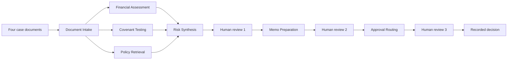

# Loan copilot learner guide

This guide teaches the pieces of `finUseCase` and how each Azure resource is used. `ARCHITECTURE.md` is the target design. This document follows the code that runs today.

A case starts as four markdown documents. Seven agents turn those documents into a risk grade, a credit memo, an approval route, and a recorded decision. The model writes the narrative. Tools compute the numbers, look up the customer, test covenants, and choose the approver.



Run everything from `AzTraining/finUseCase`. Sign in first with `az login`. The app reads secrets with that identity.

```powershell
uv run scripts/run_case.py --case case_001_strong --auto-approve
uv run scripts/show_case.py
uv run scripts/show_case.py case_001_strong-cb656f36
```

`--auto-approve` records an approval at every checkpoint, including when the recommendation is decline. Omit it to type the three review decisions yourself.

---

## 1. What each store is for

| Question during a case | Where the answer lives | Fallback when Azure is off |
|---|---|---|
| Who is this customer, and what facilities are already on the books? | Cosmos DB `customers` | `data/borrowers.json` |
| What are DSCR, leverage, and the covenant result? | Python tools in the financial and covenant agents | same tools, no network |
| Which policy and which similar past case apply? | Azure AI Search | `data/policies` and `data/precedents` |
| What stage is the case in, and what did reviewers decide? | Azure Managed Redis | `data/runtime/store.json` |
| How should the memo be worded? | Azure OpenAI `gpt-6.1-terra` | the tool results are printed without a model narrative |
| Did the run succeed, and where did time go? | Application Insights | local logs only |

That split is the main design lesson. Identity, arithmetic, policy, and the audit trail do not live in the model.

---

## 2. Configuration and Key Vault

**Resource:** Key Vault `clinic-kv-tc-training`.

**Code:** `src/loan_copilot/config.py`. Settings load from `.env`. When `USE_KEY_VAULT=true`, empty credential fields are filled from the vault with `DefaultAzureCredential`. On a laptop that credential is the `az login` user. On Azure it is the app's managed identity. An explicit value in `.env` wins over the vault, which lets you point one setting at a different resource without changing the vault.

| Empty setting | Secret read from the vault |
|---|---|
| `AZURE_OPENAI_ENDPOINT` | `az-openai-endpoint` |
| `AZURE_OPENAI_API_KEY` | `az-openai-apikey` |
| `AZURE_SEARCH_API_KEY` (only if `USE_AZURE_SEARCH=true`) | `clinic-ss-api-key` |
| `COSMOS_ENDPOINT` / `COSMOS_KEY` | `cosmos-cxn-str` and `cosmos-cxn-key` |
| `APPLICATIONINSIGHTS_CONNECTION_STRING` | `app-insights-cxn-str` |

`cosmos-cxn-str` may be an `https://` endpoint or a connection string that contains `AccountEndpoint=`. `account_from_cosmos_secret()` keeps the endpoint and uses `cosmos-cxn-key` as the account key.

If the vault call fails, the app logs a warning and keeps running. Agents then use the local files. A missing secret must not take down a case that can still be scored offline.

**Learning points**

- Put secrets in Key Vault. Keep `.env` for flags, index names, and the Redis host. Leave the secret fields empty when the vault should supply them.
- `DefaultAzureCredential` is one code path for a developer laptop and a deployed app. The difference is which identity Azure finds, not a second settings file.
- A vault read that fails open is a product choice here: the demo still runs. A production credit system would fail closed on customer lookup and decision writes.
- Never log secret values. `config.py` logs the secret name and the exception type only.

---

## 3. Azure OpenAI

**Resource:** the endpoint stored in `az-openai-endpoint`. The deployment name in `.env` is `gpt-6.1-terra`. Embeddings use `text-embedding-3-small`.

**Code:** `src/loan_copilot/llm.py`.

The vault endpoint is an OpenAI v1 base URL (`.../openai/v1`). For that shape the app builds `ChatOpenAI` with `base_url` and `model`. A classic Azure resource URL (`https://<name>.openai.azure.com`) builds `AzureChatOpenAI` with `azure_deployment` and `api_version`. One helper covers both.

`gpt-6.1-terra` is a reasoning model. The client does not send `temperature`. Structured replies use `with_structured_output(schema, method="function_calling")`. The default JSON-schema method returns HTTP 400 on these agent models because several fields are `list[dict]` (`years`, `ratios`, `policies`). Function calling accepts that shape.

Each agent still copies only the narrative fields from the model: summary, justification, memo markdown. Ratios, pass/fail, risk-grade inputs, and the approver level are written by tools before the model speaks.

If the endpoint or key is empty, `complete()` returns `None` and the agent prints the tool result. The case still finishes.

**Learning points**

- A deployment name (`gpt-6.1-terra`) is not the model family in the client library. Match the client class to the URL shape you were given.
- Structured output is a contract. If the schema contains free-form dicts, function calling is the method that this deployment accepts.
- Reasoning models ignore a custom temperature. Sending one is an error, not a style setting.
- Grounding means the model may explain a number and may not invent one. Read `agents/financial_assessment.py` and `agents/covenant_testing.py` with that rule in mind.

---

## 4. Azure Cosmos DB

**Resource:** the account in `cosmos-cxn-str`. Database `loan_underwriting`. Container `customers`. Partition key `/borrowerId`. The document `id` is the borrower id, so a point read is one request unit.

**Code:** `src/loan_copilot/domain/borrowers.py`, `scripts/seed_cosmos.py`.

`get_borrower_profile("BRW-1008")` calls `read_item(item=borrower_id, partition_key=borrower_id)`. Facilities and related parties are fields on that same document, so intake and risk synthesis share one read. `search_borrowers` runs `SELECT * FROM c WHERE CONTAINS(c.legalName, @name, true)`.

Seed the container once:

```powershell
uv run scripts/seed_cosmos.py
```

The script creates the database and container if they are missing, then upserts `data/borrowers.json`.

Unknown id `BRW-9999` raises `UnknownCustomerError` and the case stops with `UNKNOWN_CUSTOMER` (`case_008`). A missing database, a network error, or `USE_COSMOS=false` falls back to the JSON file and the case continues. A missing item is a business stop. A missing account is an infrastructure fallback. Those are different failures.

**Learning points**

- Choose the partition key for the query you actually run. Here every read is "one borrower," so `/borrowerId` makes that read a point read.
- Keep facilities on the customer document when the case always needs them together. A second container would add a second query for no gain at this size.
- Idempotent seed scripts (`create_if_not_exists`, `upsert_item`) are safe to run twice.
- Decide explicitly what happens when the store is down. This project falls back so a workshop still runs. Say that out loud when you demo it, so nobody thinks the JSON file is the system of record.

---

## 5. Azure AI Search

**Resource:** service `clinic-training-ss` at `https://clinic-training-ss.search.windows.net`. Admin key secret `clinic-ss-api-key`.

**Indexes**

| Index | Source files | What a case asks |
|---|---|---|
| `loan-policy-memory` | `data/policies/*.md` | Which lending limit, appetite, or covenant rule applies? |
| `loan-case-precedents` | `data/precedents/*.md` | Which past approval looks like this borrower? |

**Code:** `scripts/create_search_indexes.py` builds both indexes and uploads the markdown. `src/loan_copilot/domain/retrieval.py` queries them. Policy Retrieval is the agent that calls those queries.

The index schema stores a 1,536-dimension `content_vector` from `text-embedding-3-small`, with HNSW profile `loan-hnsw-profile`. Shared fields are `id`, `title`, `content`, `source_file`, and `embedding_model`. Policies add `policy_id`, `section`, `version`, `effective_date`, and `topic`. Precedents add `industry`, `amount_band`, `risk_grade`, `decision`, and `decision_date`.

Create the indexes yourself (this script writes to the search service):

```powershell
uv run scripts/create_search_indexes.py
```

The running query in `retrieval.py` is a keyword search (`search_text`) with an optional `industry` filter. If Azure search is off, errors, or returns nothing, the same function scores the local markdown by word overlap. The vector field is on the index for the next step: a hybrid query that sends text and a `VectorizedQuery` together. The app does not send that vector query yet.

**Learning points**

- Two indexes, because the fields differ. One shared schema would force empty columns on every document.
- Index creation and query are different programs. Ingestion needs the admin key and the embedding deployment. The case runner only needs a query key and the index names.
- A fallback that returns local files hides a failed index. Check the log line before you conclude the cloud index was used.
- The RAG project's index `clinic-train-tc-index` is a different schema. This app does not query it.

---

## 6. Azure Managed Redis and Entra ID

**Resource:** `redis-db-rs.eastus.redis.azure.net`, port `10000`, TLS. `.env` stores the host and port with no scheme and no password:

```text
REDIS_URL=redis-db-rs.eastus.redis.azure.net:10000
```

**Code:** `src/loan_copilot/memory/redis_store.py`, `scripts/test_redis.py`, `scripts/show_case.py`.

A URL with no scheme is treated as `rediss://`. `rediss` and no password means Entra ID. The client is built with `redis_entraid.cred_provider.create_from_default_azure_credential` and the scope `https://redis.azure.com/.default`. A `redis://` URL that contains a password stays on password auth, which is the local Redis path.

Keys written for every case:

| Key | Redis type | Contents |
|---|---|---|
| `case:{case_id}:status` | hash | `stage`, `status`, `borrower_id`, `updated_at` |
| `case:{case_id}:audit` | list | one JSON event per stage |
| `decision:{case_id}` | string | `{ "history": [...], "final": {...} }` |

`show_case.py` lists those ids and prints one case. Listing uses `KEYS case:*` and `KEYS decision:*`. `SCAN` with `MATCH` on this cache sometimes returns an empty page and cursor `0` even when the keys exist, so a scan-based list randomly printed "No cases in Redis." `KEYS` is acceptable because this cache holds a few dozen keys. On a large cache you would page `SCAN` and retry an empty cursor-0 page.

The graph's human pauses use an in-memory LangGraph checkpointer (`MemorySaver` in `graph.py`). Redis is the durable audit log you can read after the process exits. It is not the graph checkpoint in this build.

Azure Managed Redis has no Console blade in the portal. That blade exists on classic Azure Cache for Redis. Use `show_case.py` or Redis Insight to read keys.

**Learning points**

- Entra auth has two steps, and a timeout usually means the first one never happened. DNS and TCP to port 10000 must succeed before the token is sent. Open the firewall to your public IP, then grant your `az login` user the Redis data role directly. Group-based Entra access is not supported on this cache.
- Port 10000 and TLS are the Managed Redis defaults. Port 6379 and `redis://` are the local Docker defaults. The scheme tells the code which credential to use.
- A timeout before AUTH is a network finding. An HTTP 401 after connect is an identity finding. Read the exception before you change the role assignment.
- `DBSIZE` can be 33 while `SCAN` returns nothing. Trust a direct key read (`HGETALL`, `LRANGE`, `GET`) when you are debugging the listing command.
- Later `update_status` calls pass an empty `borrower_id`, so the status hash often shows a blank borrower. The id is in the intake audit note.

Check the connection on its own:

```powershell
uv run scripts/test_redis.py
```

---

## 7. Application Insights and LangSmith

**Application Insights.** The connection string comes from Key Vault secret `app-insights-cxn-str`. `src/loan_copilot/observability.py` calls `configure_azure_monitor` from `azure-monitor-opentelemetry`. On success the log says `Azure Monitor export is on`. Traces and logs then land in Application Insights, which stores them in a Log Analytics workspace.

In the portal, open the Application Insights resource, then Transaction search or Logs. A useful starting query in Logs:

```kusto
traces
| where timestamp > ago(1h)
| where message has "loan" or message has "case_"
| project timestamp, message, severityLevel
| order by timestamp desc
```

The package has to be installed in the same virtual environment that `uv run` uses. A missing `azure.monitor` is logged and the case continues. Export is observability, not a step in the credit decision.

**LangSmith.** Set `LANGSMITH_TRACING=true` and keep `LANGSMITH_API_KEY` in `.env`. The project name is `loan-underwriting-copilot`. LangSmith shows the model calls. Application Insights shows the process: startup, HTTP calls, exceptions, duration. Use both when you are asking "why did this agent say that?" and "did the process stay up?"

**Learning points**

- One connection string is the whole exporter configuration. The vault is the right place for it because the string contains the ingestion key.
- Turn Azure SDK logs down to warning (`logging.getLogger("azure")`). Otherwise token refresh fills the trace.
- A case that finishes with export disabled is still a valid case. Check the startup log if you expected telemetry and the portal is empty.
- LangSmith is off until you flip the flag. The key can sit in `.env` unused.

---

## 8. The seven agents and the tools

| Agent | What the tool decides | What the model adds |
|---|---|---|
| Document Intake | Customer profile from Cosmos or JSON. Missing file stops the case. | A short read of the four documents |
| Financial Assessment | Ratios from the uploaded statements | Trend commentary |
| Covenant Testing | Pass/fail against `data/covenants.yaml`, including the new loan | Explanation of headroom and breaches |
| Policy Retrieval | Policy and precedent passages | Which clauses matter for this case |
| Risk Synthesis | Grade inputs from the tools above | Recommendation narrative |
| Memo Preparation | Section facts already on the state | The credit memo markdown |
| Approval Routing | Approver from `data/authority_matrix.yaml` | Justification of the route |

Standard covenant floors live in `data/covenants.yaml`: minimum DSCR 1.25, maximum Debt/EBITDA 3.5, minimum current ratio 1.2, minimum interest coverage 2.0. The new loan is priced at 7% (`new_loan_rate` in settings) when the pro-forma debt service is calculated.

Authority bands in `data/authority_matrix.yaml`:

| Amount | Grades 1–4 | Grades 5–6 | Grades 7+ |
|---|---|---|---|
| ≤ $1M | Credit Officer | Senior Credit Officer | Credit Committee |
| ≤ $5M | Senior Credit Officer | Credit Committee | Credit Committee |
| ≤ $25M | Credit Committee | Credit Committee | Board Credit Committee |
| > $25M | Board Credit Committee | Board Credit Committee | Board Credit Committee |

The five MCP servers expose the same functions over HTTP on ports 8101–8105 (`scripts/run_mcp.py`). The case runner calls the Python functions in-process, so you can finish a case without starting those servers. Start a server when you want to see the tool as a separate network service.

External calls go through `resilient_call` in `resilience.py`: up to 3 attempts, then a process-local circuit breaker (5 failures in 60 seconds opens it for 30 seconds). The breaker is memory inside one process. A second terminal does not see it.

**Learning points**

- Parallel does not mean unordered. Intake must finish first. Financials, covenants, and policy then run in one LangGraph step and meet at `join_analysis`. Risk synthesis waits for all three.
- Human review is a graph interrupt with three checkpoints: risk, memo, final approval. `revise` and `send_back` loop, capped at `MAX_REVISIONS` (3).
- MCP is a packaging choice. The business rule is the function. The server is an optional door in front of that function.
- `--auto-approve` teaches the audit trail. It does not mean the model approved the loan.

---

## 9. Sample cases as lessons

`data/catalog.json` is the expected outcome. `uv run scripts/run_functional.py` runs every folder and compares the result.

| Case | Lesson |
|---|---|
| `case_001_strong` | Clean covenants, $1.5M, grade 3, Senior Credit Officer. The happy path. |
| `case_002_borderline` | Current covenants pass. The new $4M loan breaks pro-forma leverage. Conditions, Credit Committee. |
| `case_003_breach` | Several covenants fail. Recommendation is decline. `--auto-approve` still records an approval, so you can see recommendation and decision as different fields. |
| `case_004_name_mismatch` | Request says "Northwind Packing LLC". The customer record says "Northwind Packaging LLC". `name_matches` is false and the case still prices. |
| `case_005_credit_officer` | $750k lands on Credit Officer. |
| `case_006_board` | $28M lands on Board Credit Committee. |
| `case_007_missing_credit` | A required document is absent. The case stops with `MISSING_DOCUMENTS`. |
| `case_008_unknown_customer` | `BRW-9999` is not in the customer store. The case stops with `UNKNOWN_CUSTOMER`. |

Each finished case id has a suffix, for example `case_001_strong-cb656f36`. The catalog id is the folder. The Redis id is that folder plus a unique suffix for the run.

---

## 10. A workshop sequence

1. `az login`, then `uv run scripts/test_redis.py`. A timeout is the firewall. A token error is the Entra role.
2. `uv run scripts/seed_cosmos.py`. Then run `case_008` and confirm an unknown id still stops the case.
3. `uv run scripts/create_search_indexes.py`. Ask Policy Retrieval, via `case_001_strong`, for a cited policy. If the log shows a search error, you are reading the local markdown.
4. `uv run scripts/run_case.py --case case_001_strong --auto-approve`. Confirm the startup log says `Azure Monitor export is on`.
5. `uv run scripts/show_case.py` and open the new id. You should see intake through `record_decision`, and a final action of `approve`.
6. In Application Insights, find that same minute in Logs.
7. Run `case_003_breach` and `case_006_board` and compare the approver and the recommendation.

---

## 11. Where the design doc is ahead of the code

Keep these in mind so you do not look for a feature that is only in `ARCHITECTURE.md`.

| Design note | What runs today |
|---|---|
| Redis LangGraph checkpointer | `MemorySaver` for the pause. Redis stores status, audit, and decisions. |
| Redis-backed circuit breaker | The breaker lives in the process. |
| Hybrid vector query on every search | Indexes store vectors. Queries are keyword search, then local files. |
| Approved cases written back into `loan-case-precedents` | Precedents are loaded by `create_search_indexes.py` from `data/precedents`. |
| Container Apps, managed identity, private MCP network | Local process, `az login`, in-process tools. |
| GPT-4.1 and GPT-4.1-mini as two deployments | Both settings point at `gpt-6.1-terra`. |

Those gaps are the next labs, not missing configuration.
